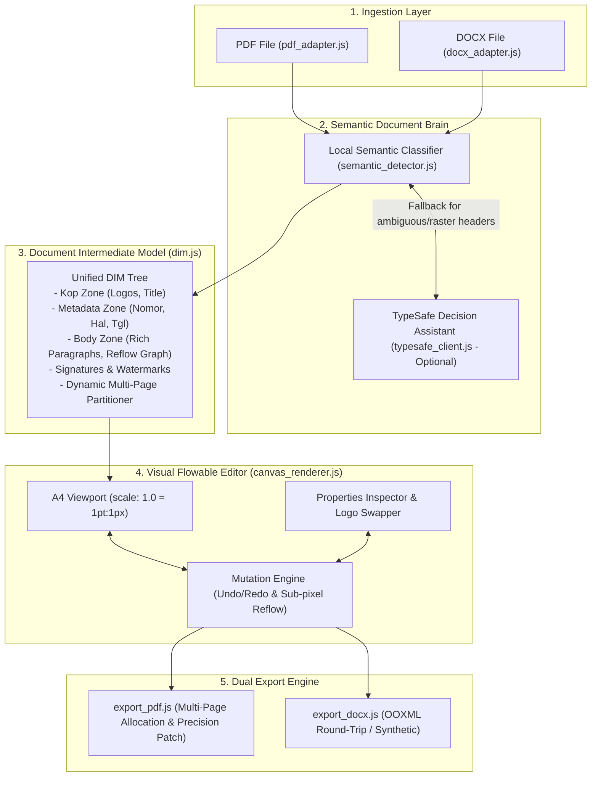

# Universal Letter Semantic Detector, Multi-Page Reflow Engine & TypeSafe Integration Design Spec

**Date:** 2026-11-08  
**Project:** Universal Document Engine (UDE-001) / GenSurat  
**Status:** Approved by Human Partner  
**Author:** Antigravity AI & Human Partner  

---

## 1. Intent & The Why

Current document processing engines often rely on hardcoded coordinates (e.g. `y < 95`, static logo boxes at `x: 46 / 448`) or flat text-patching approaches. When users upload official letters outside the original development sample—such as letters with rasterized header images, different margins, varied spacing, or documents from external organizations—the parser breaks, elements scatter into fragmented tokens, and edited paragraphs either balloon in font size (+33% due to CSS `pt` vs `px` mismatch) or collide with subsequent document sections like signatures and closing text.

The user's goal is to build an intelligent **"Document Brain"** (*otak pendeteksi & rekonstruksi dokumen*):
1. **Universal Recognition:** Automatically recognize and segment any official letter (strictly `.pdf` and `.docx` / `.doc`) into semantic zones (Kop Surat, Logos, Metadata, Recipient, Body Paragraphs, Tables, Signatures, Tembusan) without hardcoded coordinates.
2. **Word-Like Flowable Editing:** Group multi-line body text into coherent paragraph blocks so adding or editing words reflows naturally like in Microsoft Word, maintaining exact typography, inline bold/italic styling, and dynamically shifting subsequent sections downward without collision.
3. **Multi-Page Pagination (Overflow Spillover):** When paragraph expansion pushes closing text or signature blocks beyond the printable page boundary, the engine automatically creates a new Page 2 and moves the overflowing content seamlessly.
4. **High-Fidelity Preservation:** Keep background watermarks, vector lines, and logos intact, with clean dual export to both `.pdf` and `.docx`.

---

## 2. Goals, Non-Goals & Anti-Goals

### 2.1 Goals
- **Dynamic Structural Segmentation:** Eliminate all magic numbers (`y < 95`, fixed logo `x/y`). Segment documents using layout geometry and Indonesian document grammar rules.
- **True Image & Logo Extraction:**
  - In PDF: Traverse PDF.js operator lists (`paintImageXObject`, `paintInlineImageXObject`) to get actual bounding boxes and byte streams of logos and watermarks.
  - In DOCX: Parse `word/header*.xml` and relationships (`word/_rels/header*.xml.rels`) to detect and preserve Kop logos and headers.
- **Precise Typography Parity:**
  - Eliminate the 33% font ballooning bug by strictly using CSS `px` matching PDF points (`fontSize * this.scale` at 72 DPI to 1:1 viewport scale).
  - Unify measurer padding (`padding: 0`) and rendered DOM element padding (`padding: 0`) to prevent word overflow.
- **Rich Run Preservation:** Retain bold and italic phrasing (e.g. `**Unit Kegiatan Mahasiswa LDK IMIP**`) in paragraph editing, DOCX OOXML runs, and PDF export.
- **Multi-Page Pagination on Overflow:** When a paragraph expands such that elements (closing text, signature block, CC) exceed the printable bottom threshold (`y + height > pageHeight - 50`), the engine dynamically spills the content onto a newly created Page 2 in DIM, canvas, and exports.
- **TypeSafe Decision Model Assist (Hybrid Mode):** Provide an optional TypeSafe System One (Jev) helper for ambiguous layouts, rasterized kop headers, and unknown organization formats, using typed `Box` and `Choice` queries.

### 2.2 Non-Goals
- Full WYSIWYG desktop word processor (this is a targeted official document editor, not a replacement for Microsoft Word).
- Cloud storage backend or user database (system remains 100% client-side privacy-first).
- Direct standalone photo/image document ingestion (inputs are strictly `.pdf`, `.docx`, and `.doc`; PNG/JPG uploads are only for replacing logos or inserting signatures).

### 2.3 Anti-Goals
- **No Mandatory API Key:** The local deterministic engine must handle standard digital PDF/DOCX letters 100% free and offline without requiring an API key.
- **No Heavy Server Dependencies:** Total Vercel deployment footprint must remain `< 200 KB`.
- **No Destructive Whiteouts:** Use micro-targeted bounding boxes hugging tight glyph bounds so background watermarks are never erased.

---

## 3. Constraints

1. **Client-Side Runtime:** 100% vanilla ES Modules in modern browsers (Chrome, Edge, Firefox, Safari). Zero Node server runtime in production.
2. **Input Formats:** Strictly `.pdf` and `.docx` / `.doc` files.
3. **Library Footprint:** Heavy libraries (`pdfjs-dist 3.11`, `pdf-lib 1.17`, `jszip 3.10`) must be loaded on-demand via reliable CDNs (cdnjs / jsDelivr).
4. **Format Round-Trip Fidelity:** Editing a DOCX file must preserve unmodified XML elements, styles, headers, and footers (`Round-Trip Preservation`).

---

## 4. Approaches Considered

### Approach 1: 100% Deterministic Local Vision & Geometry Brain
- Operates entirely client-side using geometry clustering, PDF operator inspection, and regex grammar for Indonesian official letters.
- **Pros:** 100% free, zero external API dependencies, works offline.
- **Cons:** Struggles when Kop headers are rasterized images with non-standard placement.

### Approach 2: Hybrid Engine — Deterministic Local Brain + TypeSafe Decision Model (SELECTED)
- Local deterministic engine processes all digital PDF/DOCX files by default (instant, free, private).
- For ambiguous layouts or rasterized kop headers, system queries TypeSafe Jev:
  - `Box`: Locates logo boundaries and signature boxes in page images.
  - `Choice`: Classifies ambiguous sections or document types.
- **Pros:** Truly universal for all document formats, keeps bundle `< 200 KB`, costs fractions of a cent only when invoked.
- **Cons:** Requires user to provide an optional API key when using the TypeSafe assistant on ambiguous layouts.

### Approach 3: Full DOM Document Reconstruction
- Deconstructs uploaded documents into HTML `
` and `<table>` elements like Google Docs, rebuilding PDF from HTML on export.
- **Pros:** Smooth native typing experience.
- **Cons:** Loss of exact pixel placement and margins on exported PDFs compared to original.

**Decision:** Approach 2 was selected by the human partner.

---

## 5. Architectural Components & Data Flow

---

## 6. Detailed Technical Specifications

### 6.1 PDF Operator List & Image Extraction (`pdf_adapter.js`)
Instead of hardcoding logo positions (`x: 46/448, y: 5`), `pdf_adapter.js` inspects `page.getOperatorList()`:
- Traverses operator sequence looking for `paintImageXObject`, `paintInlineImageXObject`, and `paintJpegXObject`.
- Extracts the transformation matrix `[scaleX, skewY, skewX, scaleY, tx, ty]` to compute the exact bounding box $(x, y, w, h)$ on the A4 page.
- Identifies whether an image is:
  - **Logo:** Located in the top header region ($y < 0.25 \times \text{height}$) and aspect ratio roughly square/circular/banner.
  - **Watermark:** Large semi-transparent background image centered on the page.
  - **Signature/Stamp:** Located in the lower half near closing text.

### 6.2 Semantic Document Detector (`semantic_detector.js`)
A format-agnostic classifier that groups raw items into semantic letter zones:
1. **Header/Kop Zone:** Institution title lines, address lines, and logos above the first horizontal divider line or before Date/Metadata.
2. **Metadata Zone:** Token pairs matching `/^(nomor|no|lampiran|lamp|hal|perihal)\s*[:.]/i` grouped horizontally into unified rows, preventing fragmented `: ` and number targets.
3. **Date & Recipient Zone:** Date string (`Jakarta, ...`) and destination (`Yth. ...`, `Di Tempat`).
4. **Greeting Zone:** Opening salutation (`Dengan hormat,`, `Assalamu'alaikum wr. wb.`).
5. **Body Paragraph Zone:** Prose paragraphs with font size, line height, alignment, and inline bold/italic run arrays.
6. **Closing & Signature Zone:** Sign-off (`Hormat kami,`, `Mengetahui,`), multi-column signer blocks with titles and names.
7. **Tembusan Zone:** Numbered CC list at the footer.

### 6.3 Flowable Paragraph & Multi-Page Pagination Engine (`canvas_renderer.js`)
- **Unit Normalization:**
  - PDF viewport width = 595.28 pt. At canvas scale 1.0, 1 pt = 1 CSS px.
  - Rendered font size: `el.fontSize * this.scale` px (strictly `px`, never `pt`).
  - Text measurer `measureParagraphHeight`: Uses identical font family, `fontSize * this.scale` px, line-height 1.45, and `padding: 0`.
- **Dynamic Downward Reflow & Multi-Page Spillover:**
  - When paragraph text expands by $\Delta h = h_{\text{new}} - h_{\text{orig}}$, all elements below are shifted down.
  - If shifted elements cross the page printable boundary ($y + \text{height} > \text{pageHeight} - 50$), the engine automatically allocates a new Page 2 in `docModel.pages`, partitions the overflowing elements to the new page, and dynamically mounts a second canvas sheet in the DOM.
- **Export Multi-Page Support:**
  - `export_pdf.js`: In PDF mode, if elements spill over to a new page, `pdfDoc.addPage([pageWidth, pageHeight])` is invoked to draw the shifted signatures and closing text onto the new page without clipping.
- **Micro-Targeted Whiteout:**
  - Instead of wide white boxes, whiteout patches hug exact text line bounding boxes with 1px padding, ensuring underlying center watermarks remain visible.
- **Rich Run Formatting:**
  - Stored as Markdown strings in `el.text` (`**bold**`, `*italic*`), rendered as `<strong>`/`<em>` in DOM, and mapped to bold/italic fonts in PDF and `<w:r>` runs in DOCX.

### 6.4 TypeSafe System One Integration (`typesafe_client.js`)
Following the `typesafe-ai` skill best practices:
- **Judgments from Jev, decisions in code:**
  - `Box` Query: *"Where is the organizational logo in this header image?"* returns calibrated `[ymin, xmin, ymax, xmax]` coordinates.
  - `Choice` Query: *"Which section of an official letter does this text represent?"* with options `["kop_header", "metadata_table", "body_paragraph", "signature_block", "footer_tembusan"]`.
- Client runs via direct lightweight `fetch('https://api.typesafe.ai/...')` with the user's optional `TYPESAFE_API_KEY` stored in browser `localStorage`.
- Degrades gracefully: if no API key is provided, the local geometric classifier handles the document without interruption.

---

## 7. What is Left to the Builder

1. **Exact Clustering Thresholds:** Tuning vertical ($\Delta y \le 1.5 \times \text{lineHeight}$) and horizontal margins in `semantic_detector.js` across the 11 sample documents.
2. **TypeSafe Question Module:** Packaging the exact prompts and options in `js/engine/typesafe_client.js`.
3. **Automated E2E Suite:** Creating Playwright test cases that run across all sample PDFs (`019_SUD`, `025_SPZ`, `034_SBA`, `042_SPM`) and DOCX files.
